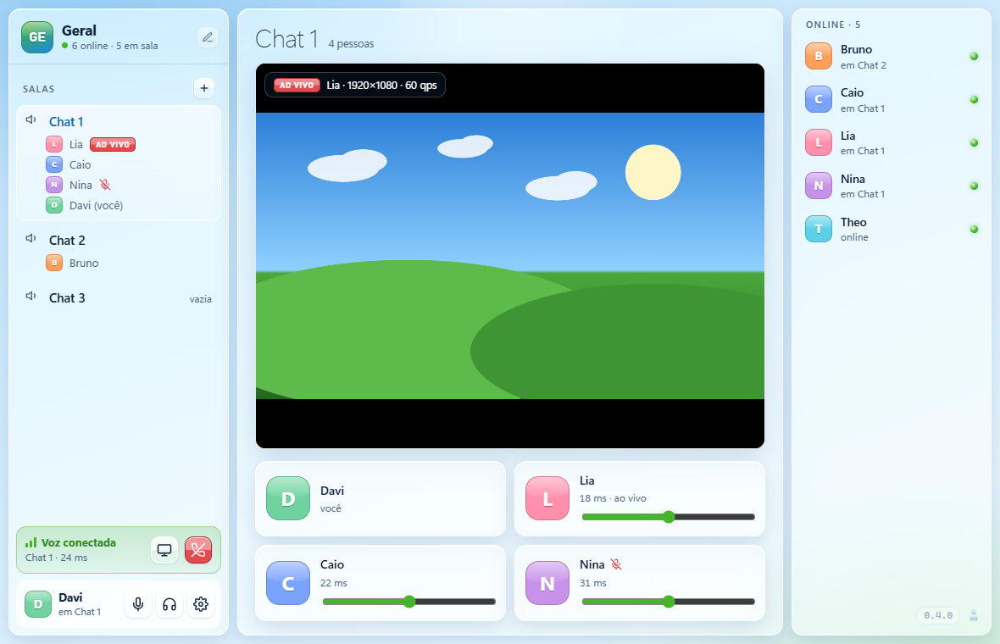
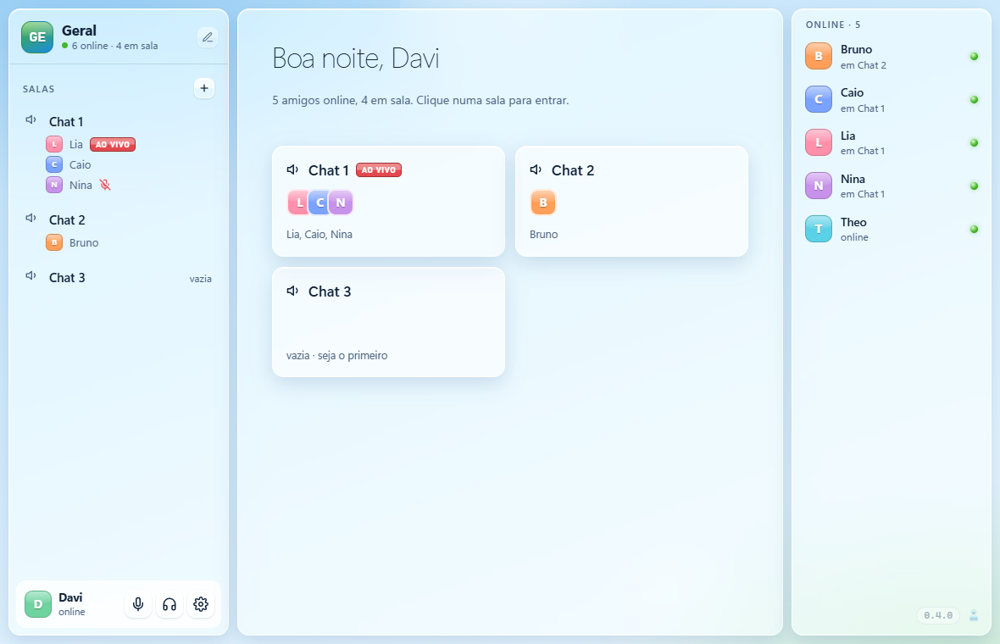
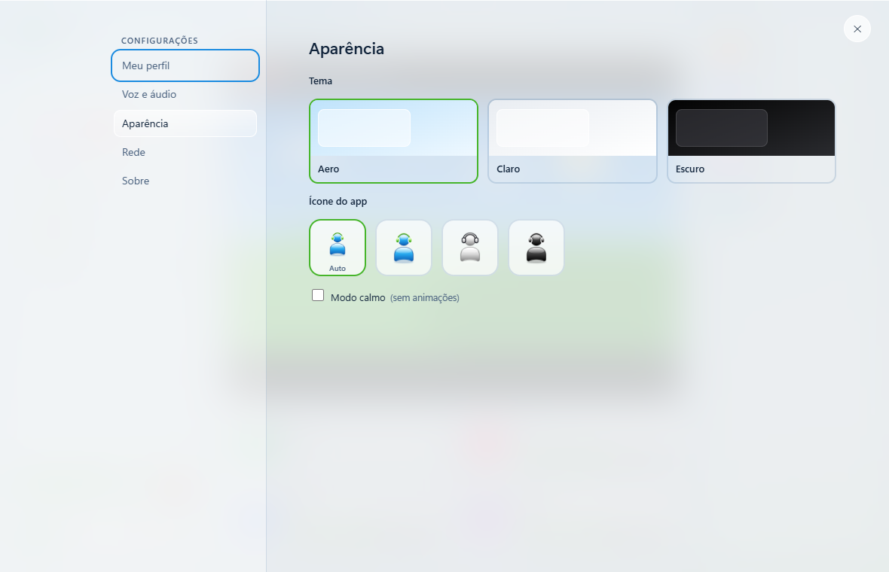
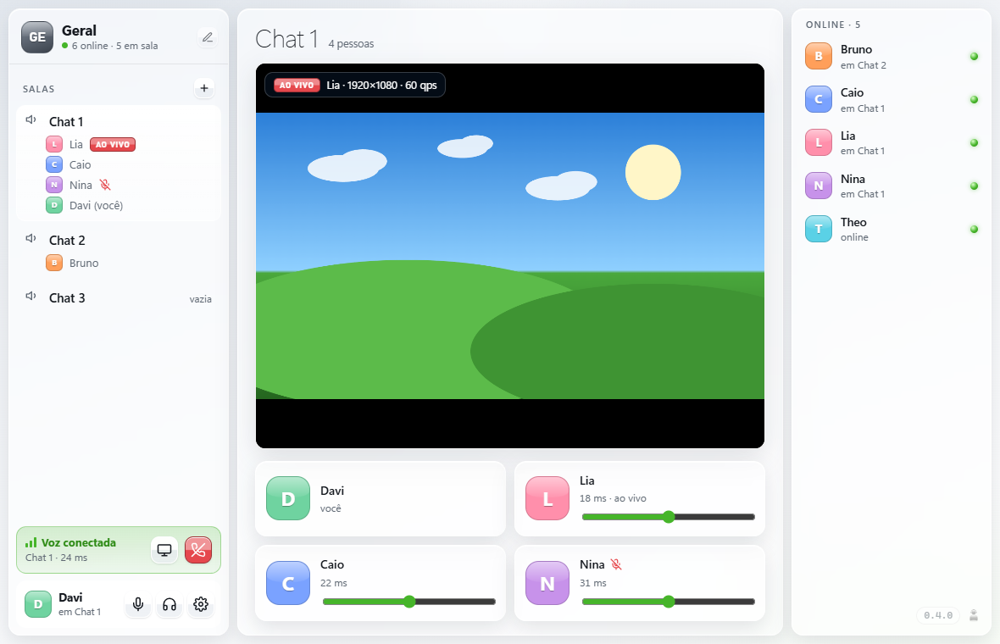
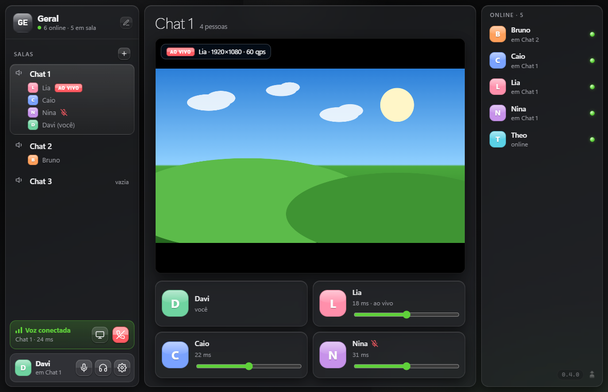
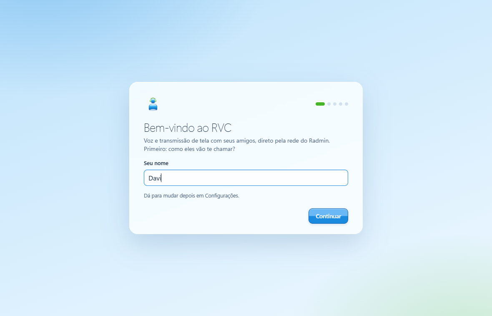

# RVC

**Voz e transmissão de tela para um grupo de amigos, pela rede do Radmin VPN. Sem servidor, sem conta, sem assinatura.**

> [!NOTE]
> **O RVC é um projeto independente, feito por hobby.** Não tem ligação com a Famatech (dona do Radmin VPN) nem com
> nenhum outro app de voz. Nomes como Radmin, Windows, AMD, NVIDIA e Intel aparecem aqui só para dizer com o que o
> RVC funciona, e pertencem aos seus donos. Problemas com o Radmin VPN em si vão para o suporte do Radmin.

[](https://github.com/Fekaziroh/rvc-releases/releases/latest)
[](https://github.com/Fekaziroh/rvc-releases/releases)
[](CHANGELOG.md)
[](#compatibilidade)



Todo mundo do grupo entra na mesma rede do Radmin VPN e abre o RVC. As salas e quem está online aparecem sozinhos,
e um clique numa sala já coloca você na conversa. A voz e a transmissão vão direto de um PC para o outro, sem
passar por nenhum servidor.

- **Salas de voz:** Chat 1, Chat 2 e Chat 3, e qualquer um cria outras. Dá para ver quem está em cada sala sem entrar.
- **Chamada privada** com uma pessoa, sem criar sala.
- **Transmissão de tela sem teto de qualidade:** 1080p, 1440p ou a resolução nativa, a 30, 60 ou 90 qps, com prévia
  antes de começar. A imagem é codificada na **placa de vídeo** (AMD, NVIDIA ou Intel).
- **Seletor próprio** de telas e janelas, com miniaturas.
- **Som do computador sem a voz dos amigos** ao transmitir a tela inteira, ou **só o som da janela** ao transmitir uma janela.
- **Nome do grupo** no topo, **foto de perfil** e **três temas** no estilo Aero: Aero, Claro e Escuro.
- **Microfone sob controle:** teste com "Ouvir minha voz", volume, sensibilidade, saída de áudio e um **aviso** quando
  o microfone de alguém só capta silêncio.
- Volume por pessoa, silenciar, parar de ouvir todo mundo e tela cheia.
- **Configuração inicial** em 5 passos no primeiro uso.
- **Atualiza sozinho:** o número da versão, no canto, acende quando sai versão nova.

| Tela inicial | Configurações |
|---|---|
|  |  |
| **Tema Claro** | **Tema Escuro** |
|  |  |



## Como instalar

1. Crie ou entre em uma rede **Radmin VPN** (todos do grupo na mesma rede).
2. Baixe e execute o instalador da **[versão mais recente](https://github.com/Fekaziroh/rvc-releases/releases/latest)**.
   - Se aparecer **"O Windows protegeu o seu PC"**: clique em **Mais informações** e depois em **Executar assim mesmo**
     (o instalador ainda não tem assinatura digital; veja [Assinatura do código](#assinatura-do-código)).
3. Na primeira vez, o Windows pergunta sobre o **Firewall**: marque **redes públicas e privadas** e clique em **Permitir**
   (o Windows trata a rede do Radmin como "pública").

Depois disso, o próprio app avisa quando sair versão nova: o número no canto inferior direito fica verde; é só clicar.
Nome, foto, tema e configurações ficam guardados no seu PC e continuam depois de atualizar.

## Como funciona

```
 PC do Davi ──┐        rede Radmin VPN (26.x.x.x)        ┌── PC da Lia
              ├──── voz e tela vão direto, de PC para PC ────┤
 PC do Caio ──┘     (nada passa por servidor do RVC)      └── PC da Nina
```

- **Quem está online:** cada RVC avisa os outros pela rede do Radmin a cada poucos segundos.
- **Voz:** WebRTC, direto entre quem está na mesma sala.
- **Transmissão:** a tela é capturada pelo Windows, codificada em H.264 na placa de vídeo e enviada direto para cada
  pessoa que está assistindo. Quem transmite manda uma cópia para cada espectador, então o upload necessário é a
  qualidade escolhida × o número de pessoas assistindo.
- **Não existe dono da sala:** a sala continua viva enquanto houver alguém dentro.

## Compatibilidade

| | Suporte |
|---|---|
| **Windows** | Windows 10 (versão 2004 ou mais nova) e Windows 11, 64 bits. |
| **Rede** | Radmin VPN, com todos do grupo na mesma rede. A velocidade máxima do Radmin é de 100 Mbps. |
| **Transmissão** | Placas de vídeo AMD, NVIDIA e Intel com codificador H.264. Sem ele, o RVC usa um modo mais simples, pelo navegador interno. |
| **Som do computador** | Windows 10 versão 2004 ou mais nova. |
| **Componentes** | Microsoft WebView2 (já vem no Windows 10/11 atualizado; o instalador baixa se faltar). |
| **Portas** | UDP 47800 e TCP 47801 a 47849, só na placa de rede do Radmin. |
| **Idioma** | Português. |

As versões são numeradas 0.x.y. Cada versão sai primeiro como **experimental** (marcada como *Pre-release*), para
testar; quando está boa, vira a versão oficial e chega a todo mundo pela atualização automática.

## Privacidade

Tudo fica no seu PC e na rede do Radmin do seu grupo. O RVC não tem conta, não coleta dados e não manda nada para
nenhum servidor dele. A única coisa que vai para a internet é a pergunta ao GitHub se há versão nova (ao abrir e a
cada 6 horas). A voz, a transmissão, o seu nome e a sua foto só circulam entre os PCs da sua rede do Radmin.

## Assinatura do código

O instalador ainda não tem assinatura digital paga, então o Windows pode avisar ao baixar ou abrir. Em algumas
versões o Microsoft Defender já marcou o instalador por engano (um palpite da inteligência artificial dele, com o
final `!ml`, comum em apps novos com poucos downloads).

- Toda versão é assinada com a chave de atualização do RVC: o app só instala atualizações feitas por ele.
- A assinatura gratuita para projetos de código aberto ([SignPath Foundation](https://signpath.org)) está nos planos
  para quando o código for aberto.
- Responsável pelos commits e por aprovar cada versão: [Fekaziroh](https://github.com/Fekaziroh).

## Problemas e ideias

- Algo não funciona? Abra um [relato de problema](https://github.com/Fekaziroh/rvc-releases/issues/new/choose).
- Dúvidas e ideias: [Discussões](https://github.com/Fekaziroh/rvc-releases/discussions).

## Código-fonte

O código do RVC ainda não é público; este repositório guarda só os instaladores e as novidades de cada versão.
Feito com [Tauri](https://tauri.app) e o WebView2 da Microsoft. Os componentes de terceiros que vão no instalador
estão em [THIRD-PARTY-NOTICES.md](THIRD-PARTY-NOTICES.md).
